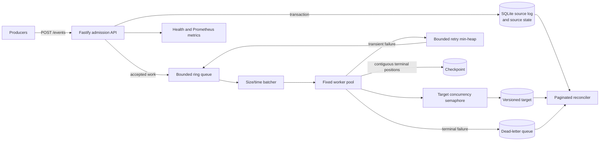
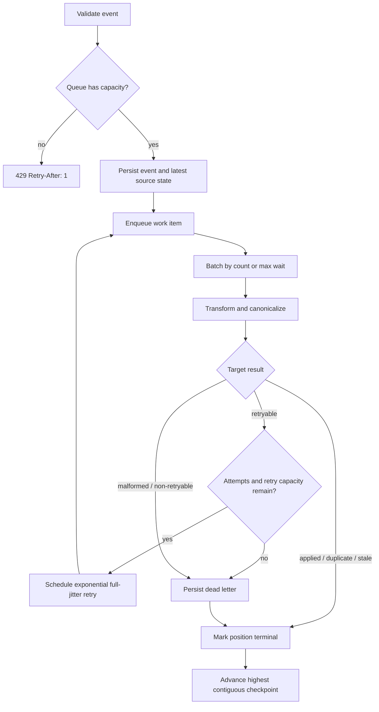
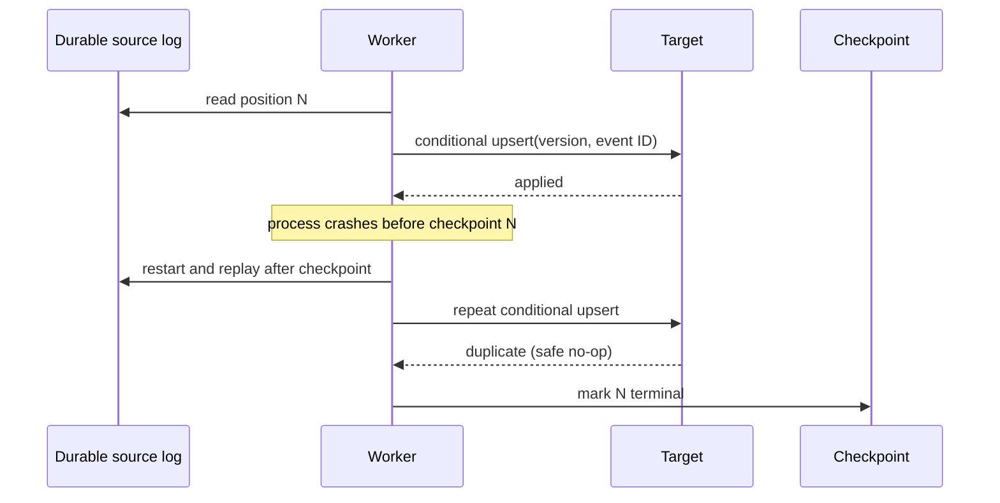

# Distributed Data Migration Pipeline

A standalone TypeScript reference implementation of a bounded, restart-safe data migration pipeline. It accepts versioned source events, transforms them in parallel, writes them idempotently to a target, retries transient failures with exponential full jitter, advances only contiguous checkpoints, and proves the final state with paginated reconciliation.

The project deliberately implements the core queueing and scheduling algorithms instead of hiding them behind a framework. SQLite supplies durable local state; the process-local queue and workers model the semantics that a production broker and consumer group would provide across hosts.

## What this demonstrates

- Bounded admission and explicit HTTP backpressure (`429` plus `Retry-After`)
- Batching by size or age, with a hard maximum batch size
- A fixed worker pool plus a separate target-concurrency semaphore
- Per-event batch outcomes, so one failure does not poison successful siblings
- At-least-once processing with idempotent, version-guarded target writes
- Exponential backoff with full jitter, a retry min-heap, bounded retry capacity, and a durable dead-letter queue
- Crash-safe replay from the highest contiguous terminal checkpoint
- Paginated merge reconciliation using counts, versions, and canonical content hashes
- Prometheus-format metrics, Pino structured logs, health/readiness, load profiles, Docker, and CI

## System design





The checkpoint is not simply the largest completed position. Workers may finish out of order, so a `Set` retains completed gaps until every earlier position is terminal. This prevents a restart from skipping unfinished work.



### Delivery and consistency model

This is **at-least-once**, not exactly-once. A crash can repeat a target write, but it cannot corrupt target state:

- `event_id` is unique at source admission.
- Target writes run in a transaction and accept only a higher `record_version`.
- Repeating the same version and event ID returns `duplicate`.
- An older or reordered version returns `stale`.
- A checkpoint advances only after a write is successful/idempotent or the event is durably dead-lettered.

The write path favors consistency and durability over availability. When capacity is exhausted it rejects new HTTP work explicitly instead of buffering without bound or silently dropping data. During a target outage, already accepted events retry up to configured bounds and may become durable dead letters; producers see backpressure when the admission queue fills. Reconciliation is the final correctness boundary.

## Runtime components and data structures

| Component       | Structure                     | Why it is used                                                                       | Main cost                         |
| --------------- | ----------------------------- | ------------------------------------------------------------------------------------ | --------------------------------- |
| Admission       | Fixed-capacity circular queue | Predictable memory and O(1) enqueue/dequeue without array shifting                   | O(1)                              |
| Worker registry | `Map<workerId, state>`        | Stable identity and direct worker-state updates; status can count processing workers | O(1) update, O(workers) snapshot  |
| Checkpoint gaps | `Set<position>`               | Deduplicates out-of-order terminal offsets while waiting for a contiguous prefix     | O(1) expected insert/lookup       |
| Retry scheduler | Stable binary min-heap        | Retrieves the earliest due retry without repeatedly sorting all retries              | O(log r) schedule/take            |
| Target limiter  | FIFO semaphore                | Caps expensive target calls independently of batch-worker count                      | O(1) acquire/release amortized    |
| Reconciliation  | Two paginated ordered cursors | Full comparison with memory bounded by page size                                     | O(s + t) time, O(page size) space |

The end-to-end hot path is O(n log r) in the worst case because retry scheduling dominates; events that do not retry are effectively O(n). Hashing is O(payload size). Memory is O(queue capacity + retry capacity + checkpoint gaps + reconciliation page size), all explicitly bounded except the durable database.

Dynamic programming would add little here. Retry timing, queueing, checkpoint-prefix detection, and ordered reconciliation have direct greedy/streaming solutions. DP becomes appropriate if the migration adds an optimization problem with overlapping subproblems—for example, choosing dependency-respecting migration groups under a cost/capacity budget. It would not improve the current scheduler.

## Storage model

SQLite runs in WAL mode with `synchronous=FULL`:

- `source_events`: immutable ordered event log with unique event IDs
- `source_records`: latest versioned source state per record
- `target_records`: latest transformed target state, hash, and last event ID
- `checkpoints`: highest contiguous terminal source position
- `dead_letters`: terminal failures with original event, classification, attempts, and message

SQLite makes the repository runnable from a clean clone and makes crash semantics observable. It is not presented as a horizontally scalable broker or multi-writer database.

## Run locally

Prerequisites: Node.js 24 LTS and npm. The repository pins the expected major in `.nvmrc`.

```bash
nvm use
npm ci
cp .env.example .env
npm run build
npm start
```

The defaults listen on `http://localhost:3000` and store state in `./data/migration.sqlite`. Environment variables are read directly; source `.env` in your shell or use your preferred environment loader.

Submit an event:

```bash
curl -i http://localhost:3000/events \
  -H 'content-type: application/json' \
  -d '{
    "eventId": "event-1",
    "recordId": "customer-42",
    "recordVersion": 1,
    "type": "upsert",
    "payload": {
      "name": "Ada Lovelace",
      "email": "ada@example.com",
      "status": "active"
    }
  }'
```

A successful admission returns `202` only after the event and latest source state are durable. Reusing `eventId` returns `409`; invalid input returns `400`; an oversized request returns `413`; a full queue returns `429` with `Retry-After: 1`.

```bash
curl http://localhost:3000/health
curl http://localhost:3000/metrics
curl -X POST http://localhost:3000/reconciliation
```

Development mode uses `tsx` watch:

```bash
npm run dev
```

### Docker Compose

```bash
docker compose up --build
curl http://localhost:3000/health
docker compose down
```

The non-root runtime container persists SQLite at `/data/migration.sqlite` in the named `migration-data` volume. Add `-v` to `docker compose down` only when intentionally deleting migration data.

## Configuration

| Variable                         |                   Default | Effect                                      |
| -------------------------------- | ------------------------: | ------------------------------------------- |
| `DATABASE_PATH`                  | `./data/migration.sqlite` | SQLite file (`:memory:` is useful in tests) |
| `HOST` / `PORT`                  |        `0.0.0.0` / `3000` | HTTP bind address                           |
| `QUEUE_CAPACITY`                 |                    `1000` | Maximum admitted in-memory work items       |
| `BATCH_SIZE`                     |                      `50` | Preferred batch size                        |
| `MAX_BATCH_SIZE`                 |                     `500` | Hard batch-size cap                         |
| `MAX_BATCH_WAIT_MS`              |                     `100` | Maximum wait for a partial batch            |
| `WORKERS`                        |                       `4` | Concurrent batch loops                      |
| `TARGET_CONCURRENCY`             |                       `2` | Maximum simultaneous target calls           |
| `TARGET_TIMEOUT_MS`              |                    `2000` | Per-target-call timeout                     |
| `MAX_ATTEMPTS`                   |                       `5` | Total attempts before dead-lettering        |
| `RETRY_BASE_MS` / `RETRY_MAX_MS` |           `100` / `10000` | Exponential full-jitter bounds              |
| `RETRY_CAPACITY`                 |                    `2000` | Maximum scheduled retries                   |
| `PAYLOAD_LIMIT_BYTES`            |                   `65536` | Fastify request-body limit                  |

Invalid or internally inconsistent values fail at startup. In particular, batch size cannot exceed its hard cap, target concurrency cannot exceed workers, and retry base cannot exceed retry maximum.

## Failure handling

| Failure mode                     | Behavior                                                                  | Recovery/correctness boundary                                                  |
| -------------------------------- | ------------------------------------------------------------------------- | ------------------------------------------------------------------------------ |
| Invalid or malformed input       | Reject before durable admission, or dead-letter malformed replay data     | Validation errors are visible; no silent coercion                              |
| Duplicate event ID               | HTTP `409`                                                                | Producer chooses a new logical event ID or treats conflict as already admitted |
| Queue saturation                 | HTTP `429` and `Retry-After`                                              | Producer retries with backoff; process memory remains bounded                  |
| Slow target                      | Semaphore limits target pressure; queue fills and propagates backpressure | Capacity tuning and scaling; no unbounded promise creation                     |
| Transient target failure/timeout | Exponential full-jitter retry                                             | Bounded attempts and retry heap; then durable DLQ                              |
| Partial batch failure            | Each event has its own outcome                                            | Successful siblings checkpoint independently; only failed events retry         |
| Out-of-order completion          | Terminal positions held in a `Set`                                        | Checkpoint advances only through the contiguous prefix                         |
| Process crash after target write | Source replay repeats the event                                           | Target event/version guard converts the repeat to an idempotent no-op          |
| Checkpoint persistence failure   | Event is retried                                                          | Safe replay may duplicate work, never skip it                                  |
| Retry heap saturation            | Event is dead-lettered                                                    | Explicit bounded degradation rather than memory growth                         |
| Permanent target/data failure    | Durable DLQ entry                                                         | Operator remediates/replays; reconciliation remains failed meanwhile           |
| Target outage and recovery       | Retries and producer backpressure                                         | Resumption is safe because writes are versioned and idempotent                 |

No circuit breaker is included in v1: the bounded concurrency, timeout, retry policy, and backpressure are sufficient to expose the core mechanics without another state machine. For a remote target in production, add a breaker around the target adapter (for example [opossum](https://www.npmjs.com/package/opossum)) and instrument open/half-open transitions.

## Testing

```bash
npm test
npm run test:coverage
npm run verify
```

The Jest suite covers queue bounds and waiting producers, stable heap order, semaphore limits, batch count/time thresholds, retry timing, checkpoint gaps, canonical transforms, source/target transactions, idempotent duplicates, stale versions, partial failures, target timeouts and recovery, malformed events, DLQ and retry capacity, crash replay, checkpoint-write replay, reconciliation mismatches, HTTP validation/backpressure contracts, metrics, runtime shutdown, generation, and load-profile reporting.

`npm run verify` also runs Prettier checking, typed ESLint, TypeScript checking, and a production build. GitHub Actions repeats the same quality gates with coverage on Node 24.

## Load testing

The autocannon runner starts an isolated in-process service and temporary SQLite database, drives HTTP admission, waits briefly for drain, prints JSON, and removes its temporary state.

```bash
npm run load:test -- --profile=steady
npm run load:test -- --profile=burst
npm run load:test -- --profile=producer-heavy
npm run load:test -- --profile=slow-target
npm run load:test -- --profile=outage
npm run load:test -- --profile=recovery
npm run load:test -- --profile=reduced-workers
npm run load:test -- --profile=large-batches
npm run load:test -- --profile=small-batches
```

Each result includes request rate, p99 latency, errors/timeouts/non-2xx responses, queue/worker/retry depth, checkpoint position and lag, checkpoint-derived throughput, unique target rows, DLQ count, CPU time, and resident memory.

One observed `steady` run on 10 October 2026 processed 500 requests/s for 10 seconds with 35 ms p99, zero errors/timeouts/non-2xx responses, a final checkpoint of 5,010, zero lag, approximately 499.5 checkpointed records/s, 997 unique target records, zero dead letters, and about 201 MiB RSS. This is a local functional baseline, not a production capacity claim; compare profiles on the same machine and commit before drawing conclusions.

## Observability and operations

- `GET /health` returns readiness plus queue depth, active workers, retry depth, checkpoint, source position, and checkpoint lag. A non-running pipeline returns `503`.
- `GET /metrics` exposes Prometheus text format, including received/processed/failed/retried/DLQ counters; queue, worker, retry, checkpoint, and lag gauges; processing and batch histograms; reconciliation failures; and prefixed Node process metrics.
- Every 10 seconds the service logs a Pino operational summary containing pipeline state, RSS/heap, and process CPU counters.
- `POST /reconciliation` performs a full paginated comparison and returns bounded mismatch samples plus complete mismatch counts.

Suggested alerts are sustained checkpoint lag, retry-queue growth, any DLQ increase, reconciliation failure, frequent `429`s at the ingress/load-balancer layer, and p99 target latency approaching `TARGET_TIMEOUT_MS`.

## Technology choices

Runtime versions are pinned for reproducibility. The primary stack is Node.js 24 LTS, TypeScript 6.0.3, Fastify 5.12.5, better-sqlite3 13.0.3, Pino 10.4.0, Zod 4.6.5, Jest 30.5.2, autocannon 8.0.0, and `@prometheus-io/client` 0.16.1. The last replaces the deprecated `prom-client` package line.

### Build versus buy: npm abstractions

The following versions and registry maintenance timestamps were checked on 10 October 2026.

| Alternative                                      | Checked version | It can replace                                                               | What remains your responsibility                                                       |
| ------------------------------------------------ | --------------: | ---------------------------------------------------------------------------- | -------------------------------------------------------------------------------------- |
| [p-limit](https://www.npmjs.com/package/p-limit) |           7.3.3 | The target semaphore for simple promise concurrency                          | Durable admission, fairness requirements, retry/DLQ, checkpoints, metrics              |
| [p-map](https://www.npmjs.com/package/p-map)     |           7.1.0 | Concurrent mapping within a batch, including backpressure-oriented iteration | Durable source, cross-batch ordering, retry scheduling, replay semantics               |
| [p-queue](https://www.npmjs.com/package/p-queue) |           9.3.3 | In-process priority/concurrency/rate-limited scheduling                      | Crash durability, distributed ownership, idempotency, DLQ/checkpoint storage           |
| [p-retry](https://www.npmjs.com/package/p-retry) |           8.0.1 | Per-operation retry policy                                                   | Global retry capacity, a visible retry queue, persistent replay, DLQ policy            |
| [opossum](https://www.npmjs.com/package/opossum) |          10.0.0 | Circuit breaker around the target adapter                                    | Domain retryability, idempotency, queue admission, recovery runbooks                   |
| [BullMQ](https://www.npmjs.com/package/bullmq)   |          6.3.12 | Durable Redis-backed jobs, delayed retries, worker concurrency, events       | Redis operations, job/domain idempotency, target version guards, source reconciliation |
| [ioredis](https://www.npmjs.com/package/ioredis) |           6.0.0 | Redis connectivity for a custom queue/coordination layer                     | Nearly all migration semantics unless paired with a queue framework                    |

Small promise libraries reduce code but do not create durable or distributed guarantees. BullMQ is the most direct next step when Redis is acceptable: it removes the process-local queue and retry heap, but the migration still needs deterministic transforms, target idempotency, checkpoint/reconciliation policy, and observability.

### Infrastructure alternatives

| Service                                                                                               | Prefer it when                                                                                            | Trade-off versus this project                                                                            |
| ----------------------------------------------------------------------------------------------------- | --------------------------------------------------------------------------------------------------------- | -------------------------------------------------------------------------------------------------------- |
| [Apache Kafka](https://kafka.apache.org/documentation/) or [Redpanda](https://docs.redpanda.com/)     | High-throughput ordered partitions, retained replay, multiple consumer groups                             | Strong operational model and partition-key design; offset commits still need idempotent targets          |
| [Redis Streams](https://redis.io/docs/latest/develop/data-types/streams/)                             | Existing Redis estate, consumer groups, moderate durable streaming needs                                  | Simpler operations but retention/claiming/backlog discipline remains yours                               |
| [RabbitMQ](https://www.rabbitmq.com/docs)                                                             | Flexible routing, acknowledgements, work queues, and mature broker operations                             | Replay/history and latest-state reconciliation need separate design                                      |
| [Amazon SQS](https://docs.aws.amazon.com/AWSSimpleQueueService/latest/SQSDeveloperGuide/welcome.html) | Managed queueing with minimal broker operations                                                           | Standard queues are at-least-once; FIFO throughput/dedup windows and DLQ redrive require explicit design |
| PostgreSQL                                                                                            | A durable outbox, transactional state, moderate queue volume, and one operational database are preferable | Polling/locking and vacuum/contention must be measured; not a general streaming broker                   |
| MongoDB change streams                                                                                | The source of truth already lives in MongoDB and resume tokens fit the migration                          | Couples replay availability and retention to the source cluster/oplog                                    |

The core guarantees should survive any substitution: durable admission, bounded work, at-least-once delivery, idempotent target mutation, monotonic version rules, safe replay, explicit terminal failures, and end-to-end reconciliation.

## Scaling beyond one process

At roughly 10× the demonstrated workload, first measure the slowest stage, then tune target concurrency, batch size, queue/retry capacities, database write latency, and checkpoint frequency. Move SQLite to a production database if its single-writer behavior becomes material. Preserve a deterministic partition key (`recordId`) if record ordering matters.

At 100× or multi-host scale:

1. Replace the process-local admission queue and retry heap with a durable broker.
2. Partition by `recordId` and run a consumer group; do not allow two unordered owners to race versions without the target guard.
3. Keep event IDs and target conditional writes as the idempotency boundary.
4. Store checkpoints/consumer offsets and DLQ state durably outside a worker process.
5. Shard or partition source/target storage, run reconciliation by key range, and aggregate complete counts.
6. Autoscale from backlog age and target saturation, not CPU alone.
7. Add circuit breaking, rate contracts, deployment draining, DLQ redrive tooling, tracing, SLOs, and disaster-recovery exercises.

Exactly-once marketing does not remove side-effect design. Even with broker transactions, a non-transactional external target still needs an idempotency key or conditional version write.

## Repository layout

```text
src/
  app.ts                    HTTP admission and operational endpoints
  config.ts                 validated runtime controls
  generator.ts              deterministic local event generator
  observability.ts          Prometheus metrics and operational summaries
  reconciliation.ts         paginated source/target merge comparison
  runtime.ts                lifecycle and dependency composition
  pipeline/                 batching, retries, checkpoints, transforms, workers
  storage/                  SQLite schema and repositories
  structures/               bounded queue, stable min-heap, semaphore
scripts/
  load-test.ts              executable autocannon/fault simulator
  load-profiles.ts          reproducible load and failure profiles
test/                       unit, integration, restart, and API tests
```

## Engineering decisions and extensions

- The durable source event is written before enqueue. Capacity is checked first, and JavaScript serializes synchronous admission so an accepted HTTP response cannot correspond to an unqueued event.
- Replay intentionally waits when the queue is full. This bounds memory during startup after a large backlog.
- Batch siblings are processed independently with `Promise.all`; errors are classified inside each item rather than rejecting the whole batch.
- Canonical hashing trims names and lowercases email addresses before SHA-256, so reconciliation compares the same representation the target stores.
- Reconciliation streams ordered pages from both sides. Samples are capped, but mismatch counts remain complete.
- Graceful shutdown drains with a deadline; forced interruption remains safe because the durable log and checkpoint replay unfinished positions.

Natural extensions are a DLQ inspection/redrive API, trace propagation, pluggable source/target adapters, breaker state, broker consumers, range-partitioned reconciliation, schema evolution/versioned transformers, and deployment-level readiness/draining controls.

## Commit style

Changes use unnumbered Conventional Commit subjects such as `feat: add paginated reconciliation`, `fix: preserve checkpoint replay safety`, and `chore: update runtime tooling`.

## License

MIT
